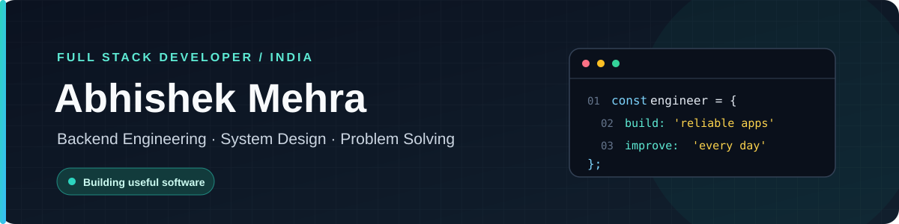

<!-- ================= HEADER ================= -->

### नमस्ते 👋

I build web applications, backend APIs and practical software solutions, with a focus on reliable architecture and maintainable code.

  
  
  

---

## 👨‍💻 About Me

I'm a Full Stack Developer from India with **4 years of professional experience** building web applications and backend solutions.

- 🚀 Contributed to and delivered 10+ projects, including production applications and proof of concepts.
- ⚙️ Work across frontend, backend APIs, databases and application integration.
- 🧩 Interested in clean architecture, maintainable code and solving real engineering problems.
- 🏗️ Currently strengthening System Design (HLD/LLD), backend scalability and database fundamentals.
- 🧠 Practising Data Structures & Algorithms.
- 🤝 Open to collaborating on useful open-source projects.

---

## 🧰 Technology Stack

### Frontend

  

### Backend

  

### Databases & Cloud

  

### Engineering Tools

  

### AI Tools

  
  
  
  

---

## 🏗️ Selected Engineering Work

### 🏋️ [Workout Form Coach](https://github.com/abhimeh-1824/workout-form-coach)
Computer-vision fitness analysis platform focused on pose estimation, exercise tracking and biomechanics feedback.

**Engineering areas:** Python, FastAPI, MediaPipe, computer vision, asynchronous processing.

### 📊 [Daily Tracker](https://github.com/abhimeh-1824/Daily-Tracker)
Personal productivity and study tracking application with daily planning, progress analytics and data export.

**Engineering areas:** JavaScript, Firebase, Firestore, authentication, analytics.

### 🏏 [Book Cricket 3D](https://github.com/abhimeh-1824/cricket_game)
Full-stack 3D book-cricket application with real-time multiplayer features, game sessions and administration tools.

**Engineering areas:** React, Node.js, Express, MongoDB, Socket.IO, Three.js.

> These are selected public repositories. More projects and experiments are available in my repositories.

---

## 🧠 Current Engineering Focus

| Area | Focus |
|---|---|
| Backend Engineering | API design, authentication, modular services |
| Databases | Data modelling, indexing, query performance |
| System Design | HLD, LLD, scalability and design trade-offs |
| Reliability | Error handling, validation, observability |
| DevOps | Docker, deployment and infrastructure fundamentals |
| Problem Solving | Data Structures & Algorithms |

---

## 📊 GitHub Analytics

<picture>
  <source media="(prefers-color-scheme: dark)" srcset="./assets/overview.dark.svg" />
  
</picture>

<picture>
  <source media="(prefers-color-scheme: dark)" srcset="./assets/languages.dark.svg" />
  
</picture>

<picture>
  <source media="(prefers-color-scheme: dark)" srcset="./assets/contributions.dark.svg" />
  
</picture>

---

## 🤝 Connect

  

  

**Build thoughtfully. Learn continuously. Improve every day.**

